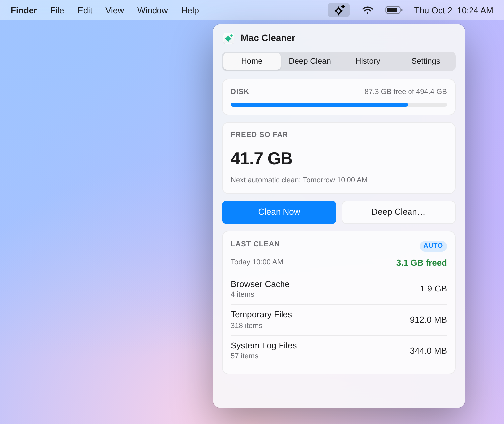
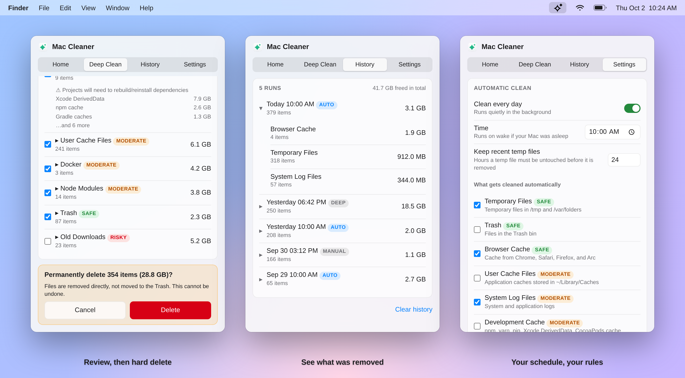

# mac-cleaner-cli

<p align="center">
  
</p>

<p align="center">
  Free up disk space on macOS with a single command. Removes caches, logs, Homebrew leftovers, Xcode DerivedData, and junk files — all from your terminal.<br>
  No subscription. No telemetry. No bloatware.
</p>

<p align="center">
  <strong><a href="https://guhcostan.github.io/mac-cleaner-cli/">🌐 Website</a></strong>
</p>

<p align="center">
  <a href="https://www.npmjs.com/package/mac-cleaner-cli"></a>
  <a href="https://www.npmjs.com/package/mac-cleaner-cli"></a>
  <a href="https://github.com/guhcostan/mac-cleaner-cli/actions/workflows/ci.yml"></a>
  <a href="https://opensource.org/licenses/MIT"></a>
</p>

<p align="center">
  <a href="https://nodejs.org"></a>
  <a href="https://www.apple.com/macos/"></a>
  <a href="https://www.typescriptlang.org/"></a>
  <a href="https://socket.dev/npm/package/mac-cleaner-cli"></a>
</p>

<p align="center">
  <a href="https://github.com/guhcostan/mac-cleaner-cli/stargazers"></a>
  <a href="https://github.com/guhcostan/mac-cleaner-cli/network/members"></a>
</p>

<p align="center">
  <a href="https://ko-fi.com/guhcostan"></a>
</p>

<p align="center">
  <strong>🪟 Also available for Windows:</strong> <a href="https://github.com/guhcostan/windows-cleaner-cli">windows-cleaner-cli</a>
</p>

---

## ⚡ Quick Start

```bash
npx mac-cleaner-cli
```

That's it. No installation needed. The CLI will:

1. 🔍 **Scan** your Mac for cleanable files
2. 📋 **Show** you what was found with sizes
3. ✅ **Let you select** exactly what to clean
4. 🗑️ **Clean** only what you chose

## 🖥️ Desktop App (menu bar) — new

Prefer not to open a terminal? **Mac Cleaner** is a menu bar app built on the same scanners as the CLI.

<p align="center">
  <picture>
    <source media="(prefers-color-scheme: dark)" srcset="assets/screenshots/app-dark.png">
    
  </picture>
</p>

- 🧹 **Cleans automatically every day** at the time you pick (temp files, browser cache, logs — you choose). If your Mac was asleep, it catches up when it wakes.
- ⚡ **Clean Now** from the menu bar whenever you want
- 🔥 **Deep Clean (hard delete)** — scan many more places, review the biggest items per category and permanently delete only what you tick, after a confirmation
- 📊 **History** of every run with the space freed per category, plus a notification after each automatic clean
- 🛡️ Risky categories are never cleaned unattended, and recently used temp files are left alone

<p align="center">
  <picture>
    <source media="(prefers-color-scheme: dark)" srcset="assets/screenshots/app-tour-dark.png">
    
  </picture>
</p>

Install or update it with one command:

```bash
npx mac-cleaner-cli app install
# or, without Node.js:
curl -fsSL https://guhcostan.github.io/mac-cleaner-cli/install.sh | bash
```

Both pick the build for your Mac (Apple Silicon or Intel), download the latest release, verify its SHA-256 checksum and install it into `/Applications`. Then give it **Full Disk Access** (System Settings → Privacy & Security) so it can see every cache.

The `.dmg` files are also on [Releases](https://github.com/guhcostan/mac-cleaner-cli/releases), but the app isn't signed with an Apple Developer ID yet, so a `.dmg` downloaded with a browser shows a Gatekeeper warning first ([why, and how to open it](desktop/README.md#install)). See [`desktop/`](desktop/README.md) for details and how to build it yourself.

## 🎬 The CLI In Action

<p align="center">
  
</p>

## ✨ Features

| Feature | Description |
|---------|-------------|
| 🚀 **One Command** | Just run `npx mac-cleaner-cli` — no complex setup |
| 🎯 **Interactive** | Select exactly what you want to clean with checkboxes |
| 📁 **File Explorer** | Drill down (`→`) into categories to select specific folders/files |
| 🛡️ **Safe by Default** | Risky items hidden unless you use `--risky` |
| 👀 **Dry Run** | Preview exactly what would be deleted with `--dry-run` |
| ♻️ **Optional Backups** | Move items to a backup folder instead of deleting, restore later |
| 🤖 **Scriptable** | `scan --json` and `clean --categories … --yes` for cron and CI |
| 🖥️ **Menu Bar App** | Daily automatic cleaning, Deep Clean and history — `npx mac-cleaner-cli app install` |
| 🔍 **Smart Scanning** | Finds caches, logs, dev files, browser data, and more |
| 📱 **App Uninstaller** | Remove apps completely with all associated files |
| 🔧 **Maintenance** | Flush DNS cache, free purgeable space |
| 🔒 **Privacy First** | 100% offline — no data ever leaves your machine |
| 📦 **Minimal Dependencies** | Only 5 runtime deps, all from trusted maintainers |

## 💰 vs. Paid Alternatives

| | Mac Cleaner CLI | CleanMyMac X | DaisyDisk |
|---|---|---|---|
| **Price** | **Free** | $39.95/year | $9.99 one-time |
| **Open Source** | ✅ | ❌ | ❌ |
| **Telemetry / Analytics** | ❌ None | ⚠️ Yes | ⚠️ Yes |
| **Works via terminal** | ✅ | ❌ | ❌ |
| **Menu bar app** | ✅ | ✅ | ❌ |
| **Automatic daily cleaning** | ✅ | ✅ | ❌ |
| **CI/CD friendly** | ✅ | ❌ | ❌ |
| **Customizable** | ✅ Fork it | ❌ | ❌ |
| **App Uninstaller** | ✅ | ✅ | ❌ |
| **File-level selection** | ✅ | ✅ | ✅ |

## 🎯 What It Cleans

### 🟢 Safe (always safe to delete)

| Category | What it cleans |
|----------|---------------|
| `trash` | Files in the Trash bin |
| `temp-files` | Temporary files in /tmp and /var/folders |
| `browser-cache` | Chrome, Safari, Firefox, Arc cache |

### 🟡 Moderate (generally safe)

| Category | What it cleans |
|----------|---------------|
| `system-cache` | Application caches in ~/Library/Caches |
| `system-logs` | System and application logs |
| `dev-cache` | npm, yarn, pip, Xcode DerivedData, CocoaPods |
| `node-modules` | Stale dependencies beside `package.json` (moderate) |
| `rust-artifacts` | `target` beside `Cargo.toml` (moderate) |
| `node-build-artifacts` | Node build output beside `package.json` (risky) |
| `go-artifacts` | Ignored `bin`/`dist` beside `go.mod` (risky, explicit opt-in) |
| `homebrew` | Homebrew download cache **and old formula versions** (`brew cleanup --prune=all`) |
| `docker` | Unused images, stopped containers, build cache — **only the types you select** |

> `docker` and `homebrew` are **not** "safe": their cleanup is performed by the
> external tool, and it removes more than downloaded files. Docker removes images
> that aren't used by a *running* container (they must be pulled or rebuilt
> again), and Homebrew removes old formula versions. Docker **volumes are never
> touched** — that's your data, not cache.

### 🔴 Risky (use `--risky` flag)

| Category | What it cleans |
|----------|---------------|
| `downloads` | Downloads older than 30 days |
| `ios-backups` | iPhone and iPad backup files |
| `mail-attachments` | Downloaded email attachments |
| `duplicates` | Duplicate files (keeps newest) |
| `large-files` | Files larger than 500MB |
| `language-files` | Unused language localizations — **breaks the app's code signature** |
| `git-worktrees` | Stale or orphaned git worktrees (agents, feature checkouts) |

## 📖 Usage

### Basic Usage

```bash
# Interactive mode — scan, select, and clean
npx mac-cleaner-cli

# Include risky categories
npx mac-cleaner-cli --risky

# Preview what would be deleted, without deleting anything
npx mac-cleaner-cli --dry-run

# Enable file picker for all categories
npx mac-cleaner-cli --risky -f
```

### Folder-Level Selection (Interactive)

In interactive mode, press `→` on supported categories to drill into specific folders/files:

- `↑↓` navigate • `←` back • `→` enter • `space` select • `a` all • `i` invert • `⏎` submit

Supported categories: User Cache Files, Temporary Files, System Log Files, Development Cache, Browser Cache, Homebrew Cache.

### Scripting & Automation (non-interactive)

```bash
# Scan only — see what can be cleaned without deleting anything
npx mac-cleaner-cli scan

# Machine-readable output for scripts and integrations
npx mac-cleaner-cli scan --json
npx mac-cleaner-cli scan --json --verbose   # include item paths

# Clean specific categories without prompts (great for cron/CI)
npx mac-cleaner-cli clean --categories trash,browser-cache,homebrew --yes

# Preview first
npx mac-cleaner-cli clean --categories dev-cache --dry-run

# Clean everything that is safe, no selection UI
npx mac-cleaner-cli clean --all --yes
```

Risky categories (downloads, iOS backups, etc) are always skipped unless you pass `--unsafe`.

### Repository artifacts

```bash
# Scan only a workspace; repeat --root for additional workspaces.
npx mac-cleaner-cli scan --category rust-artifacts --root ~/dev --json --verbose

# Simulate validated Node build cleanup as one JSON document.
npx mac-cleaner-cli clean --categories node-build-artifacts --unsafe --root ~/dev --dry-run --json

# Go requires explicit inclusion or an explicit Go category, plus risky enablement.
npx mac-cleaner-cli clean --categories go-artifacts --unsafe --root ~/dev --dry-run --json

# Live review: selections start empty. A separate confirmation precedes cleanup.
npx mac-cleaner-cli --live --root ~/dev
npx mac-cleaner-cli scan --live --root ~/dev
```

All repository rules require a readable, regular, non-symlink marker in the **immediate parent**. Node build names are `.next`, `.turbo`, `.parcel-cache`, `coverage`, `dist`, `build`, `out`, and `.cache`. Generic Node names (`coverage`, `dist`, `build`, `out`, `.cache`) and Go `bin`/`dist` additionally require a positive Git ignore match. They are omitted in non-Git projects. A marker or ignore match does not prove that every untracked file is disposable.

Git's current index and HEAD both protect tracked content, including staged additions/removals, conflicts, symlinks and submodules. Nested `.git` files/directories also protect candidate ancestors. Git failures, unreadable contents and incomplete inspection prevent eligibility. Candidate symlinks and traversal through symlinks below canonical roots are rejected. Node wins a Node/Go `dist` collision when both categories are requested; a Go-only request assigns it to Go.

Default roots are `~/Projects`, `~/Developer`, `~/Code`, `~/dev`, `~/workspace`, and `~/repos`. `extraPaths.projects` adds roots for all repository categories; legacy `extraPaths.nodeModules` adds roots only for `node-modules`. A nonempty repeatable `--root` list replaces these roots for that command, without changing other scanners. Roots are canonicalized and restricted to directories below HOME, `/Users`, or `/Volumes`; broad HOME/system roots are rejected. Empty extra-path arrays add nothing.

Add these settings to the existing `~/.maccleanerrc` (or `~/.config/mac-cleaner-cli/config.json`):

```json
{
  "extraPaths": { "projects": ["~/work"], "nodeModules": [] },
  "excludePaths": ["**/keep.txt", "docs/build"],
  "includeEcosystems": [],
  "nodeModulesDaysOld": 30,
  "projectScanMaxDepth": 4,
  "parallelScans": true,
  "concurrency": 4
}
```

`--exclude <pattern>` repeats and adds to configured keep paths. A basename matches any component; slash-containing patterns match root-relative prefixes on component boundaries. `*` and `?` match within a component, and `**` as a whole component matches zero or more components. Absolute paths, traversal, empty patterns, negation, braces and brackets are invalid. Any excluded descendant protects its entire artifact directory, including across overlapping roots. Malformed repository policy fails closed.

Node dependencies must be at least `nodeModulesDaysOld` days old (integer 0–365, default 30), using the newer of the project-directory mtime and **every candidate entry's newest mtime**, including directories and links. `projectScanMaxDepth` is 0–16 (default 4): children of parents at depth 0 through 4 are inspected. Artifact contents are fully inspected regardless of this discovery cap. Known hidden worktree containers are traversed; dependency contents and Git metadata are pruned during discovery.

Node and Rust are enabled by default. `--include go`, config `includeEcosystems: ["go"]`, or explicitly selecting `go-artifacts` opts into Go; `--all`, `--unsafe`, and `--risky` alone do not. `defaultCategories` narrows default category selection; `excludeCategories` always wins. Risky Node/Go categories start with no preselected files in interactive review. Scripted selection requires the existing explicit risky flag.

Selected repository items are revalidated against their original immutable scan context, current markers/config/keep rules, refreshed Git state, canonical roots and device/inode identity before cleanup. No new discoveries are added during clean. Dry-run exercises the same validation without creating backup sessions or changing files. Outside-HOME roots may be cleaned permanently, but backup mode rejects them with `BACKUP_UNSUPPORTED_PATH`; backup failure never falls back to deletion. Validated selected ancestors cover descendants once, while independently selectable scan rows remain available.

These checks reduce stale-result risk; they are not atomic with deletion, do not detect active builds, and cannot guarantee inactivity. Byte counts are **logical estimates**, including regular-file and symlink-entry sizes; they are not physical disk-block measurements.

### Clean JSON and scan events

`clean --json` requires `--all` or `--categories`; actual cleanup also requires `--yes`. Dry-run does not. Stdout contains one versioned document, including empty and failed runs. Diagnostics go to stderr; JSON mode does not prompt or open a browser. Exit status is 0 for a complete scan/plan/clean (including empty), 1 for scan/config/validation/execution failure; invalid CLI usage follows Commander's nonzero convention.

Per-filesystem-item outcomes include category, path, status, estimated size and rejection/skip reasons. Statuses are `deleted`, `backed-up`, `would-delete`, `would-back-up`, `rejected`, or `skipped`. Covered children report `SKIPPED_COVERED_BY_PARENT` with zero duplicate accounting. External tools such as Docker and Homebrew have action-level outcomes, not invented filesystem deletion records.

Existing aggregate fields remain. Actual `totalFreedSpace`, `totalBackedUpSize`, and `totalCleanedItems` are separate from `wouldFreeSpace`, `wouldBackUpSize`, and `wouldCleanItems`; dry-run actual counters are zero. Scan JSON retains `totalSize`, `totalItems`, category fields and verbose item `path`/`size`, adding optional `id`, `fileCount`, `newestEntryModifiedAt`, and artifact evidence. IDs hash category plus NUL plus canonical path; they identify rows and do not authorize cleanup.

Library callers can pass `onEvent` and `signal: AbortSignal` to scanner options. Events are `start`, `progress`, `candidate`, `warning`, and `done`, correlated by `runId` and category where applicable. The registry shares one repository discovery pass per request. Cancellation returns no usable cleanup plan. The Promise API remains; repository callers pass `scanResult.context` as the additive fourth argument to `clean(items, dryRun, backupDir, context)`. Bare repository cleanup without scan evidence is refused.

Live review requires a terminal and cannot be combined with JSON. Use `s`/`m`/`p` for size/newest-mtime/path sorting, `/` for search, `n`/`b` for pages, arrows to move, space to select, and `q` to cancel. Selection survives view changes. Enter during scanning cannot submit; after completion it finishes review before the ordinary final confirmation and validation. `scan --live` is read-only.


### Uninstall Apps

Remove applications completely with all their preferences, caches, and support files:

```bash
npx mac-cleaner-cli uninstall
```

### Maintenance Tasks

```bash
# Flush DNS cache (may require sudo)
npx mac-cleaner-cli maintenance --dns

# Free purgeable space
npx mac-cleaner-cli maintenance --purgeable

# Delete Time Machine local snapshots (requires sudo, asks for confirmation)
sudo npx mac-cleaner-cli maintenance --timemachine

# Preview it first, or skip the prompt
npx mac-cleaner-cli maintenance --timemachine --dry-run
sudo npx mac-cleaner-cli maintenance --timemachine --yes
```

Local snapshots are taken automatically by Time Machine and can grow to hundreds of gigabytes.
Deleting them is irreversible — they are your only local rollback point while the backup disk is
disconnected — but macOS recreates them as needed once it is reconnected.

### Other Commands

```bash
# List all available categories
npx mac-cleaner-cli categories

# Manage configuration
npx mac-cleaner-cli config --init
npx mac-cleaner-cli config --show

# Manage backups
npx mac-cleaner-cli backup --list
npx mac-cleaner-cli backup --restore <dir>
npx mac-cleaner-cli backup --clean

# Install or update the menu bar app (--no-open, --dir <folder>)
npx mac-cleaner-cli app install
```

### Backups (opt-in)

By default, cleaning is **permanent**: files are removed with `rm -rf` and do
**not** go to the Trash.

You can opt into backups by setting `backupEnabled` in `~/.maccleanerrc`:

```json
{ "backupEnabled": true }
```

With backups on, selected items are **moved** to `~/.mac-cleaner-cli/backup/<timestamp>/`
instead of being deleted, and can be brought back with `backup --restore`.

Two honest caveats:

- **Moving does not free disk space.** The files still occupy the same volume.
  Space is only reclaimed by `backup --clean`, which deletes backups older than
  7 days permanently.
- **Docker and Homebrew cannot be backed up.** Their cleanup is performed by the
  external tool (`docker system prune`, `brew cleanup`), so there is no file for
  us to move. The CLI warns you before proceeding when these are selected.

If a backup fails, the item is **not** deleted — it stays where it is and the
failure is reported.

### Flags

```bash
-V, --version          Show version number
-h, --help             Show help
-r, --risky            Include risky categories
-d, --dry-run          Show what would be deleted, delete nothing
-f, --file-picker      Force file picker for ALL categories
-A, --absolute-paths   Show absolute paths
    --no-progress      Disable progress bars
```

### Troubleshooting

Scans tolerate unreadable paths (missing Full Disk Access, permission errors), so a
category can come back empty without an obvious reason. Set `MAC_CLEANER_DEBUG=1` to
print every skipped path and the underlying error:

```bash
MAC_CLEANER_DEBUG=1 npx mac-cleaner-cli scan
```

Exit codes: `0` on success, `1` when a category could not be scanned or an item could
not be deleted. `scan --json` also reports failures in an `errors` array.

## 💻 Global Installation

If you use this tool frequently:

```bash
npm install -g mac-cleaner-cli
mac-cleaner-cli
```

## 🔒 Security

| | |
|---|---|
| ✅ **Open Source** | All code publicly available for audit |
| ✅ **No Network** | Operates 100% offline (only `app install` talks to GitHub, to download the app) |
| ✅ **No Root Required** | All operations run as current user |
| ✅ **Minimal Deps** | Only 5 runtime dependencies |
| ✅ **CI/CD** | Every release tested with TypeScript, ESLint, and automated tests |
| ✅ **Socket.dev** | Dependencies monitored for supply chain attacks |

Found a vulnerability? Report it via [GitHub Security Advisories](https://github.com/guhcostan/mac-cleaner-cli/security/advisories/new).

## 🛠️ Development

```bash
git clone https://github.com/guhcostan/mac-cleaner-cli.git
cd mac-cleaner-cli
bun install
bun run dev      # Run in dev mode
bun run test     # Run tests
bun run lint     # Run linter
bun run build    # Build for production
```

Desktop app (Electron, lives in [`desktop/`](desktop/README.md)):

```bash
cd desktop
bun install
bun run start    # Build and launch the menu bar app
bun run test     # Run desktop tests
bun run dist     # Package .dmg/.zip into desktop/release (macOS only)
bun run screenshots  # Regenerate the README screenshots with sample data (needs Playwright)
```

## 🤝 Contributing

Contributions are very welcome! Whether it's a new scanner, a bug fix, or a documentation improvement — we'd love your help.

**Read the full guide:** [CONTRIBUTING.md](CONTRIBUTING.md)

Quick steps:
1. Fork the repo
2. Create your branch: `git checkout -b feat/my-feature`
3. Make your changes and add tests
4. Run `bun run lint && bun run test`
5. Open a Pull Request

Looking for a place to start? Check issues labeled [`good first issue`](https://github.com/guhcostan/mac-cleaner-cli/labels/good%20first%20issue) or [`help wanted`](https://github.com/guhcostan/mac-cleaner-cli/labels/help%20wanted).

## 💬 Community

- [GitHub Discussions](https://github.com/guhcostan/mac-cleaner-cli/discussions) — questions, ideas, show & tell
- [Issues](https://github.com/guhcostan/mac-cleaner-cli/issues) — bug reports and feature requests

## ⭐ Star History

If this tool saved you disk space, a star goes a long way! It helps more Mac users discover this free alternative to paid cleaners.

[](https://star-history.com/#guhcostan/mac-cleaner-cli&Date)

## 💚 Support

If this tool saved you time or disk space, consider supporting the project!

<p align="center">
  <a href="https://ko-fi.com/guhcostan"></a>
</p>

Your support helps maintain and improve this tool. Thank you! 🙏

## 📄 License

MIT License — see [LICENSE](LICENSE) for details.

---

<p align="center">
  <strong>⚠️ Disclaimer</strong><br>
  This tool deletes files from your system. While we've implemented safety measures, always ensure you have backups of important data.
</p>

<p align="center">
  Made with ❤️ for Mac users everywhere
</p>
